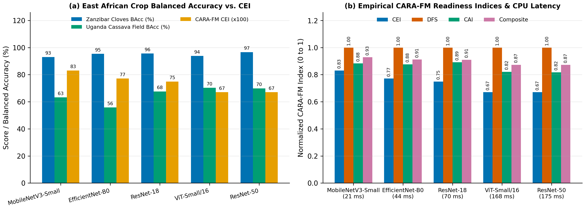

# CARA-FM: Culturally Attuned and Resource-Aware Foundation Models for East African Agriculture

[](https://proceedings.mlr.press/v302/nyalala26a.html)
[](paper/nyalala26a.pdf)
[](LICENSE)

**Innocent Nyalala** (`innocent@iitmz.ac.in`) and **Nirav Bhatt** (`niravbhatt@iitmz.ac.in`)
School of Engineering & Science, IIT Madras Zanzibar, Tanzania | Wadhwani School of Data Science & AI, IIT Madras, India

Paper (PMLR Vol. 302): [proceedings.mlr.press/v302/nyalala26a.html](https://proceedings.mlr.press/v302/nyalala26a.html) | Local PDF: [`paper/nyalala26a.pdf`](paper/nyalala26a.pdf) | Project Page: [saaillab.github.io/cara-fm/](https://saaillab.github.io/cara-fm/)

---

## Overview

Agriculture sustains roughly `175 million` people across Kenya, Tanzania, Uganda, Rwanda, and Ethiopia, contributing `25%` to `35%` of regional GDP and employing `65%` to `75%` of the workforce, yet yields remain at `30%` to `40%` of potential partly because farmers lack timely, locally grounded advisory tools in languages they speak. Published in *Proceedings of Machine Learning Research (PMLR Vol. 302, pp. 1-11, 2026)* and honored with the **Best Poster Award (Publication & Dataset Category)** at Deep Learning Indaba 2025, **CARA-FM** establishes a theoretical blueprint, governance model, and operationalized nine-index evaluation framework for building agricultural foundation models suited to East African infrastructure and cultural realities.

<p align="center">
  
</p>

### Four Core Research Questions (Section 1.1)

1. **RQ1 (Resource Constraints):** How can foundation models operate reliably in East African farming environments given `1-4 GB` RAM smartphones, intermittent electricity, and limited connectivity?
2. **RQ2 (Epistemological Pluralism):** What formal knowledge representations link Indigenous agricultural knowledge with statistical machine learning without appropriating community heritage?
3. **RQ3 (Multidimensional Evaluation):** Which quantitative metrics evaluate systems jointly across computational efficiency, agronomic impact, and cultural acceptability?
4. **RQ4 (Participatory Governance):** Which institutional and cooperative ownership structures distribute data value equitably back to smallholder communities?

---

## Regional Deployment Constraints (Table 1)

| Challenge Category | East African Field Reality | Design Consequence for CARA-FM |
|---|---|---|
| Infrastructure | `27%` internet penetration; `13%` outside mobile coverage; intermittent electricity | Offline-first edge inference and opportunistic store-and-forward sync |
| Computational | `1-4 GB` smartphone RAM (`< $100` handsets); CPU-only rural inference | Compact artifacts `< 500 MB` with deterministic CPU execution |
| Linguistic | `200+` regional languages; sparse agricultural NLP corpora; routine code-mixing | Multilingual speech/text support paired with specialized crop glossaries |
| Data Representation | Smallholder intercropping, indigenous cultivars, local pest variants | Community-driven participatory collection with multi-tier validation |
| Economic Viability | `0.5-2 ha` smallholder plots; tight cash liquidity | Free or low-cost public-good access with local maintenance capacity |
| Knowledge Systems | Generationally transmitted seasonal, soil, and pest indicators | Hybrid symbolic-neural graphs connecting qualitative and quantitative cues |
| Cultural Practices | Collective cooperative decisions and predominantly oral communication | Participatory co-design and voice-accessible advisory interfaces |

---

## Design Principles & Four Architectural Pillars (Section 3)

CARA-FM is anchored on four core principles (**Context-First Design**, **Community Ownership**, **Knowledge Pluralism**, and **Radical Efficiency**) realized through four interlocking pillars:

1. **Pillar 1: Community-Driven Data Architecture** combines agricultural extension officers (`mkulima`-facing collection), multi-tiered expert validation, low-bandwidth synchronization protocols, and community data trusts governing licensing and benefit distribution.
2. **Pillar 2: Indigenous Knowledge Systems (IKS)** represents dynamic crop-weather-soil relationships as hybrid symbolic-neural knowledge graphs with probabilistic translation layers, elder attribution records, and access protections against knowledge appropriation.
3. **Pillar 3: Edge-First Model Design** splits inference hierarchically between lightweight on-device phone models (for routine grading and triage via pruning, quantization, and distillation) and regional district servers when intermittent links permit, updated through communication-efficient federated learning.
4. **Pillar 4: Participatory Governance** establishes farmer-majority cooperative boards, regular algorithmic and social audits, pre-defined revenue-sharing formulas, and community grievance channels.

---

## Nine Formal Evaluation Indices (Table 2)

This repository packages all nine formal CARA-FM indices in [`cara_fm/`](cara_fm/) with a Draft 2020-12 JSON Schema in [`schemas/cara_fm_evaluation_schema.json`](schemas/cara_fm_evaluation_schema.json):

| Dimension | Index | Full Name | Operational Scope |
|---|---|---|---|
| Technical | `CEI` | Computational Efficiency Index | Combines balanced accuracy with `< 500 MB` size margin and CPU latency |
| Technical | `DFS` | Deployment Feasibility Score | Checks offline capability, CPU-only runtime, `< 500 MB` disk, `1-4 GB` RAM, `< 250 ms` latency |
| Technical | `MPP` | Multilingual Performance Parity | Ratio of Kiswahili / local-language advisory accuracy to English baseline |
| Agricultural | `YIP` | Yield Improvement Potential | Relative harvest gain vs. control baseline (`50%` gain normalized to `1.0`) |
| Agricultural | `IOE` | Input Optimization Efficiency | Proportional reduction in water, fertilizer, or pesticide expenditure |
| Agricultural | `IAE` | Information Access Enhancement | Mean reach, farmer comprehension rate, and actionable advisory delivery |
| Cultural | `CAI` | Cultural Alignment Index | Local crop taxonomy fit, Kiswahili glossary parity, offline UI readiness, IKS fit |
| Cultural | `CAS` | Community Acceptance Score | Mean farmer adoption and recommendation trust across seasonal surveys |
| Cultural | `KPV` | Knowledge Preservation Value | Retention of elder-verified IKS concepts under community attribution rules |

```python
from cara_fm import evaluate_system_card, validate_scorecard_dict

card = evaluate_system_card(
    model_id="MobileNetV3-Small",
    task_domain="zanzibar_cloves_and_uganda_cassava",
    balanced_accuracy=78.16,
    model_size_mb=5.95,
    peak_ram_gb=0.189,
    cpu_latency_ms=20.69,
    offline_capable=True,
    requires_gpu=False,
    local_language_scores=[0.7816, 0.7816],
    high_resource_lang_score=0.7816,
    local_taxonomy_coverage=0.7816,
    swahili_glossary_parity=1.0,
    offline_ui_ready=1.0,
    iks_compatibility=0.75,
)
assert validate_scorecard_dict(card.to_dict()) == []
```

---

## African Agricultural AI Precedents (Table 3)

| Initiative | Country | Core Mechanism | Reported Field Impact |
|---|---|---|---|
| **Farmerline (Darli AI)** | Ghana | 27-language voice/messaging agricultural chatbot | `2.5x` yield increase; `1M+` farmers reached |
| **Apollo Agriculture** | Kenya | ML credit scoring paired with satellite crop analytics | `2.6x` production increase among smallholders |
| **Aerobotics** | South Africa | Aerial and vision-based pest/disease scouting | `20-40%` crop loss reduction across 18 countries |

Community benchmarks such as **Masakhane** (`52` African languages) and the **African Union Continental AI Strategy** (2025-2030) reinforce three lessons synthesized in Section 5 of the paper: language-first delivery drives uptake, sustainable deployment joins public research, extension networks, and cooperatives, and transparent local ownership builds farmer trust.

---

## Research Agenda, Risks & Mitigations (Sections 6 and 7)

- **Empirical Benchmarking & Corpus Priorities:** Systematic resource-constrained evaluation of open language backbones (`LLaMA-2`), multilingual encoders (`mT5`, `XLM-R`, `BLOOM`), and compact vision models (`ViT`, CNNs), supported by a proposed `20+`-language East African Agricultural Language Corpus, indigenous-crop imagery, and multimodal speech-text-image datasets.
- **Field Trials:** Multi-zone randomized pilot evaluations across Kenya, Ethiopia, Uganda, Tanzania, and Rwanda run jointly with national agricultural research institutes and farmer cooperatives.
- **Proactive Risk Controls:**
  - *Technical risks* (marginalized-group bias, field shift collapse, loss of traditional cues) -> regular per-class bias auditing (pair with [`saaillab/dgs-bench`](https://github.com/saaillab/dgs-bench)) and continuous local calibration.
  - *Social risks* (knowledge appropriation / digital colonialism, cultural friction, elite capture) -> participatory cooperative charters, access controls, and gradual rollout.
  - *Economic risks* (unaffordable recurring fees, farmer value extraction) -> diversified public-cooperative funding and transparent benefit-sharing agreements.

---

## Empirical Operationalization Benchmark

To test CARA-FM empirically alongside strict field-trial boundaries, [`experiments/run_cara_empirical_benchmark.py`](experiments/run_cara_empirical_benchmark.py) benchmarks five edge-to-cloud architectures (`MobileNetV3-Small`, `EfficientNet-B0`, `ResNet-18`, `ViT-Small/16`, `ResNet-50`) across two East African datasets: **Zanzibar Cloves Grading Dataset v1** (`train = 3,673`, `val = 792`, `test = 793`, 8 quality classes) and the natural **Uganda Cassava Field Split** (`train = 1,600` balanced images, `field_test = 19,397` uncurated field images, 5 classes), paired with single-thread CPU latency profiling and an offline English/Kiswahili/code-mixed agricultural symptom router (`EN = 1.000`, `SW = 1.000`, `MIX = 1.000`, yielding `MPP = 1.000` and `DFS = 1.000` for all five offline models).

| Model | Params (M) | FP32 / FP16 (MB) | CPU (ms) | Cloves BAcc (%) | Cassava Field BAcc (%) | `CEI` | `CAI` | Composite |
|---|---:|---:|---:|---:|---:|---:|---:|---:|
| **MobileNetV3-Small** | `1.53` | `5.95 / 2.91` | `20.69` | `93.07` | `63.24` | `0.8311` | `0.8829` | **`0.9285`** |
| **EfficientNet-B0** | `4.02` | `15.60 / 7.66` | `44.49` | `95.42` | `55.83` | `0.7717` | `0.8766` | `0.9121` |
| **ResNet-18** | `11.18` | `42.72 / 21.33` | `69.73` | `95.65` | `67.63` | `0.7493` | `0.8916` | `0.9102` |
| **ViT-Small/16** | `21.67` | `82.71 / 41.33` | `167.95` | `93.85` | `70.35` | `0.6709` | `0.8214` | `0.8731` |
| **ResNet-50** | `23.52` | `90.04 / 44.87` | `174.60` | `96.64` | `69.90` | `0.6707` | `0.8175` | `0.8721` |

Although `ResNet-50` attains the highest mean cross-crop balanced accuracy (`83.27%` vs. `78.16%` for `MobileNetV3-Small`), `MobileNetV3-Small` leads CARA-FM composite readiness (`0.9285` vs. `0.8721`) because it runs `8.4x` faster on CPU (`20.69 ms` vs. `174.60 ms`) within `0.189 GB` RAM and `5.95 MB` FP32 storage (`2.91 MB` FP16). `ResNet-18` occupies an intermediate operating point (`81.64%` mean balanced accuracy at `69.73 ms`, `0.9102` composite score). Agronomic and community-trial indices (`YIP`, `IOE`, `IAE`, `CAS`, `KPV`) remain explicitly `null` (`requires_field_trial`) in [`results/cara_fm_empirical_scores.json`](results/cara_fm_empirical_scores.json) pending cooperative field pilots.



---

## Running Tests & CLI Validation

```bash
pip install -e .[dev]
pytest -q
python -m cara_fm.cli --demo
```

## Citation

```bibtex
@inproceedings{pmlr-v302-nyalala26a,
  title={Culturally Attuned and Resource-Aware Foundation Models for East African Agriculture: A Theoretical Framework and Research Agenda},
  author={Nyalala, Innocent and Bhatt, Nirav},
  booktitle={Proceedings of the Deep Learning Indaba 2025 Research Track},
  series={Proceedings of Machine Learning Research (PMLR)},
  volume={302},
  pages={1--11},
  year={2026},
  url={https://proceedings.mlr.press/v302/nyalala26a.html}
}
```

## License

Consistent with the published PMLR Vol. 302 proceedings paper (`nyalala26a.pdf`, page 1), this repository is licensed under **Creative Commons Attribution 4.0 International (`CC BY 4.0`)**. See [`LICENSE`](LICENSE).
