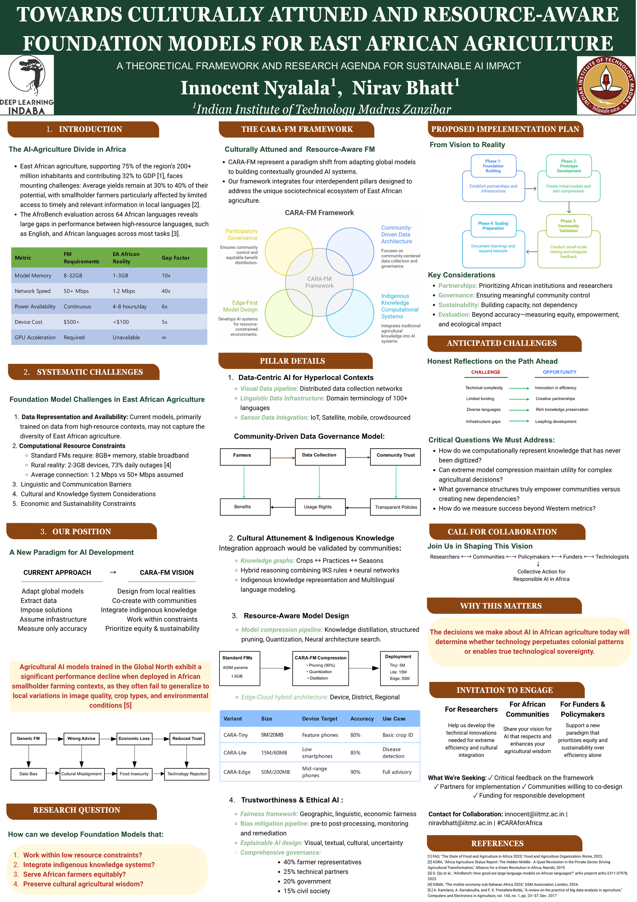
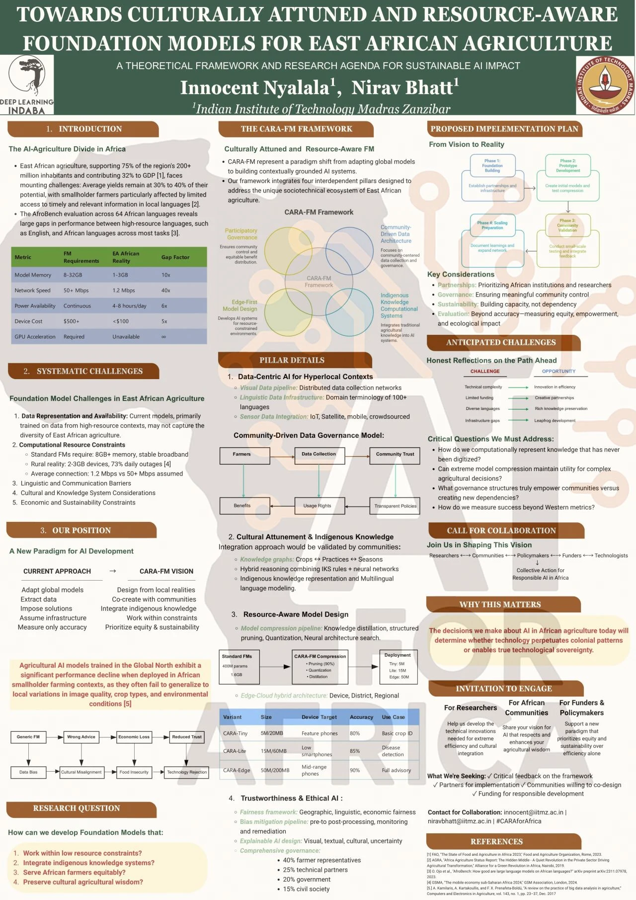

# CARA-FM: Culturally Attuned and Resource-Aware Foundation Models for East African Agriculture

**Best Poster Award (Publication & Dataset Category): Deep Learning Indaba 2025 (Kigali, Rwanda)**  
**Published in Proceedings of Machine Learning Research (PMLR Vol. 302, pp. 1–11, 2026)**

[](https://saaillab.github.io/cara-fm/)
[](https://saaillab.github.io/papers/cara-fm/)
[-15803d)](https://proceedings.mlr.press/v302/nyalala26a.html)
[](LICENSE)

**Authors:** Innocent Nyalala, Nirav Bhatt  
**Affiliation:** SAAIL Lab, School of Engineering and Science, Indian Institute of Technology Madras Zanzibar, Tanzania  



---

## Abstract

East African agriculture sustains over **175 million people** across more than **200 spoken languages**, yet mainstream foundation models fail operationally under real regional constraints: intermittent rural connectivity, entry-level smartphones limited to **1–4 GB RAM**, and structural erasure of vernacular ethnobotanical and farming knowledge systems. **CARA-FM** formulates a unified four-pillar architecture and evaluation agenda combining **Community-Driven Data Architecture**, **Indigenous Knowledge Systems**, **Edge-First Model Design** (5M–50M Tiny, Lite, and Regional Edge tiers), and **Participatory Governance**, evaluated jointly across technical efficiency, agricultural utility, and cultural acceptance.

---

## Four Architectural Pillars of CARA-FM

| Pillar | Structural Barrier Addressed | Socio-Technical & Systems Principle |
|---|---|---|
| **1. Community-Driven Data Architecture** | Smallholder under-representation & external data extraction | Participatory curation with cooperatives preserving attribution and local consent |
| **2. Indigenous Knowledge Systems** | Missing vernacular crop, soil, and pest taxonomies | Grounding multimodal representations in local Swahili and community ethnobotany |
| **3. Edge-First Model Design** | 1–4 GB Android phones & offline rural operation | Modular 5M–50M Tiny/Lite/Edge profiles quantized for CPU/INT8 inference |
| **4. Participatory Governance** | Top-down deployment misalignment | Regional audit governance anchored in communal Ubuntu/Ujamaa stewardship |

---

## Target Hardware Tiers Formulated in CARA-FM

| Deployment Tier | Hardware Memory Budget | Model Scale | Representative SAAIL Lab Implementations |
|---|---|---|---|
| **Tiny Edge** | 1–2 GB Entry Smartphone | `< 5M` Params | `CropGuardNet` (`481.6K` params, `5.00 ms` ONNX), `Ubora-AI` TFLite INT8 |
| **Lite Mobile** | 2–4 GB Field Smartphone | `5M – 20M` Params | Multi-crop DeepLabV3+ / MobileViT extension pipelines |
| **Regional Edge Hub** | Cooperative Edge / Raspberry Pi | `20M – 50M` Params | Swahili Spoken QA & local extension advisories |



---

## Evaluation Trilemma & Socio-Technical Research Agenda

Conventional foundation model benchmarks optimize unimodal English perplexity or server-GPU accuracy yet ignore rural operational failure modes. **CARA-FM** formulates joint multi-objective evaluation across three coupled axes:

1. **Technical Efficiency (`Tiny / Lite / Edge`):** Parameter count (`481.6K`–`50M`), RAM footprint within `1–4 GB` consumer Android ceilings, offline CPU latency, and INT8 quantization fidelity.
2. **Agricultural & Livelihood Utility:** Performance under natural field domain shift across East African crops (cassava, maize, Zanzibar cloves, seaweed aquaculture) audited via balanced Macro-F1 and Deployment Gap Score rather than leaky aggregate accuracy.
3. **Cultural Attunement & Sovereign Data Governance:** Alignment with coastal and East African linguistic norms (Swahili, ethnobotanical taxonomies) alongside participatory consent, benefit-sharing, and local audit governance rooted in community cooperatives.

---

## Core Design Checkpoints for East African Deployments

| Deployment Checkpoint | Failure Mode Prevented | Operational Verification |
|---|---|---|
| **Offline-First Execution** | Cellular dead-zones in rural Unguja, Pemba & mainland plots | Complete TFLite / ONNX inference with zero cloud round-trips |
| **Multilingual & Voice Interface** | English-only agronomic advisories excluding smallholders | Grounded Swahili lexicons via **Zanzibar Swahili Corpus** & **Dira** |
| **Balanced Field Validation** | High aggregate accuracy concealing minority disease failures | Per-class Recall, Macro-F1 & `DGS_F1` reporting (`DGS-Bench`) |
| **Sovereign Community Stewardship** | Extractive data monetization away from farmer cooperatives | Local license attribution & participatory governance agreements |

---

## Venue Recognition & Open Proceedings

Published in **Proceedings of Machine Learning Research (PMLR Vol. 302, pp. 1–11, 2026)** following the **Deep Learning Indaba 2025 Research Track** in Kigali, Rwanda, where the work received a **Best Poster Award (Publication & Dataset Category)**. Full open-access proceedings are hosted at [proceedings.mlr.press/v302/nyalala26a.html](https://proceedings.mlr.press/v302/nyalala26a.html).

---

## Companion SAAIL Lab Programs Realizing CARA-FM

- **Responsible AI & Governance for the Global South:** Deployment-gap auditing, data sovereignty, and African AI safety -> [Project Site](https://saaillab.github.io/projects/responsible-ai-global-south/)
- **Zanzibar Swahili Corpus & Dira Provenance Benchmark:** Detecting native coastal Swahili prose versus synthetic translationese -> [Project Site](https://saaillab.github.io/projects/swahili-dira/)
- **CropGuardNet:** 481.6K-parameter 200 FPS ONNX implementation of CARA-FM's Tiny Edge tier -> [GitHub Repo](https://github.com/saaillab/CropGuardNet)
- **ZSTC-Clove-V1 & Ubora-AI:** Participatory inspection workflow built alongside ZSTC Zanzibar clove graders -> [Project Site](https://saaillab.github.io/projects/ubora-ai/)
- **SAAIL Lab (IIT Madras Zanzibar):** AI, deep learning, computer vision, and Swahili NLP research portal -> [saaillab.github.io](https://saaillab.github.io/)

---

## Repository Contents

```text
cara-fm/
├── README.md
├── LICENSE
├── CITATION.cff
└── docs/
    ├── index.html                           # Standalone PMLR 302 project page
    └── assets/
        ├── cara-fm-poster-dli2025.png       # DLI 2025 Kigali research poster
        ├── cara-fm-dli-spotlight.webp       # Best Poster Award spotlight
        └── saail-crest.png
```

---

## Citation

```bibtex
@inproceedings{pmlr-v302-nyalala26a,
  title={Culturally Attuned and Resource-Aware Foundation Models for East African Agriculture: A Theoretical Framework and Research Agenda},
  author={Nyalala, Innocent and Bhatt, Nirav},
  booktitle={Proceedings of the Deep Learning Indaba 2025 Research Track},
  series={Proceedings of Machine Learning Research (PMLR)},
  volume={302},
  pages={1--11},
  year={2026},
  url={https://proceedings.mlr.press/v302/nyalala26a.html}
}
```

---

## License, Attribution & Commercial Restriction

All code, benchmark documentation, splits, and research artifacts in this repository are licensed strictly under **Creative Commons Attribution-NonCommercial 4.0 International ([CC BY-NC 4.0](LICENSE))** by **Innocent Nyalala & SAAIL Lab (Indian Institute of Technology Madras Zanzibar)**.

- **Non-Commercial Scientific Use Only:** Materials may be studied, cited, and adapted strictly for non-commercial academic research and educational replication.
- **Mandatory Attribution:** Any use or derivative study must explicitly acknowledge **Innocent Nyalala** ([IITMZ Profile](https://www.iitmz.ac.in/schools/engineering-and-science/faculty/prof-innocent-nyalala)) and **[SAAIL Lab](https://saaillab.github.io/)** and cite the accompanying publication above.
- **Prohibition on Unauthorized Commercialization:** Commercial deployment, paid hosting, proprietary licensing, or product commercialization is strictly prohibited without prior written authorization and direct inclusion of **Innocent Nyalala (`innocent@iitmz.ac.in`)**.

Maintained by **[SAAIL Lab](https://saaillab.github.io/)** ([IITMZ Labs](https://www.iitmz.ac.in/labs)) · School of Engineering and Science, **[Indian Institute of Technology Madras Zanzibar](https://www.iitmz.ac.in/)** · PI: **[Innocent Nyalala](https://www.iitmz.ac.in/schools/engineering-and-science/faculty/prof-innocent-nyalala)**.
